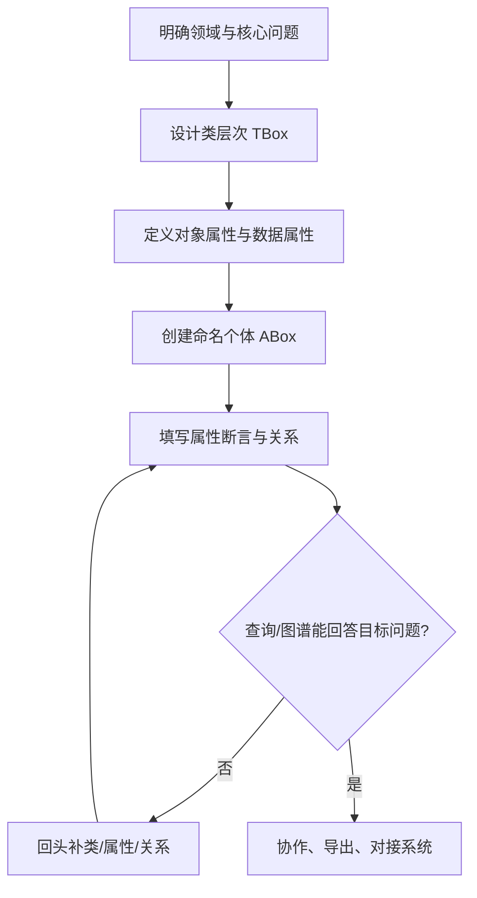

# 本体从 0 到 1：通俗入门指南

> **适用读者：** 第一次接触本体的业务或技术人员  
> **配套工具：** [WebProtégé](https://webprotege.stanford.edu)（本仓库本地部署：http://localhost:5000）  
> **相关文档：**
> - [UserManual.md](UserManual.md) — WebProtégé 完整用户手册
> - [demo-data/README.md](demo-data/README.md) — 汽车行业 Demo 数据字典
> - [demo-data/UsageTutorial.md](demo-data/UsageTutorial.md) — Demo 导入与操作教程

---

## 一、本体是什么？

如果你第一次接触本体，可以把它理解成：**给某个领域画一张「概念地图 + 关系规则 + 具体实例」**，让机器和人都能用同一套语言描述世界。

### 1.1 类比理解

| 现实世界 | 本体里叫什么 |
|---------|-------------|
| 「设备」「故障」「工单」这些**名词** | **类（Class）** |
| 「发生在设备上」「影响工单」这些**关系** | **对象属性（Object Property）** |
| 「故障代码」「严重等级」这些**字段** | **数据属性（Data Property）** |
| 「WR-001 这台焊接机器人」这种**具体事物** | **个体/实例（Individual）** |

### 1.2 两个盒子：TBox 与 ABox

本体通常分两层，这是最重要的概念：

```
┌─────────────────────────────────────┐
│  TBox（概念模型 / 规则）              │
│  · 有哪些类？                        │
│  · 类之间什么关系？                    │
│  · 属性能连什么？                      │
└─────────────────────────────────────┘
              ↓ 按规则填入
┌─────────────────────────────────────┐
│  ABox（实例数据 / 事实）              │
│  · WR-001 是一台 WeldingRobot        │
│  · FAULT-001 发生在 WR-001 上        │
│  · 它触发了停线异常，影响了工单        │
└─────────────────────────────────────┘
```

- **TBox** = 先定「游戏规则」
- **ABox** = 再往里面填「真实数据」

本仓库 Demo 文件 `demo-data/automotive-equipment-fault-demo.ttl` 就是完整示例：既有类/属性定义（TBox），也有 `WR-001`、`FAULT-20250711-001` 等实例（ABox）。

---

## 二、创建本体的 5 个阶段（推荐顺序）

### 阶段 0：想清楚要描述什么

先回答三个问题：

1. **领域边界**：只管「设备故障影响生产」，还是连供应链、人员都管？
2. **核心问题**：你想回答什么？例如：「某台设备故障后，哪些工单会受影响？」
3. **谁会用**：业务人员填表？工程师查关系？AI 系统做推理？

**原则：从小做起。** 先覆盖一条完整因果链，再扩展。

Demo 的核心链就很清晰：

```
设备故障 → 生产异常 → 工单影响
```

---

### 阶段 1：画类层次（TBox — 类）

把领域里的**概念**列出来，再排成树：

```
Thing（万物之根）
 └── Equipment（设备）
      └── ProductionEquipment（生产设备）
           ├── WeldingRobot（焊接机器人）
           ├── CNCMachine（数控机床）
           └── PressMachine（冲压设备）
 └── FaultEvent（故障事件）
      ├── SensorFault（传感器故障）
      └── MechanicalFault（机械故障）
 └── WorkOrder（工单）
      ├── ProductionWorkOrder（生产工单）
      └── MaintenanceWorkOrder（维护工单）
```

**操作习惯：**

- 父类放**共性**（所有设备都有编号、状态）
- 子类放**特性**（焊接机器人 vs 数控机床）
- 不要一开始就分太细，够用就行

#### 在 WebProtégé 中一步一步创建（新手跟着做）

目标：在空项目里建出上面这棵类树。整段约 **10～15 分钟**。

##### 步骤 A：创建空项目并进入编辑页

1. 浏览器打开 http://localhost:5000 ，登录（本地默认：`admin` / `admin123`）
2. 首页点击 **Create Project...**
3. 填写：
   - **Project name：** `我的第一本体-类层次练习`
   - **Description：** `按 OntologyLearning 练习建类`
4. 确认创建，在项目列表中**点击项目名**进入编辑界面

##### 步骤 B：确认能看到 Class hierarchy

进入项目后，左侧通常已有 **Class hierarchy** 面板。

- 若没有：点击 **Add Content** → 选择 **Class hierarchy**
- 树顶上应看到 `owl:Thing`（万物之根；所有类最终都挂在它下面）

> **口诀：** 先点选「父类」，再创建「子类」。父类选错，类就会挂错位置。

##### 步骤 C：建第 1 条分支 — 设备

| 次序 | 先选中（父类） | 操作 | 英文名（创建时填写） | 中文标签（随后添加） |
|------|----------------|------|---------------------|----------------------|
| C1 | `owl:Thing` | Create subclass | `Equipment` | 设备 |
| C2 | `Equipment` | Create subclass | `ProductionEquipment` | 生产设备 |
| C3 | `ProductionEquipment` | Create subclass | `WeldingRobot` | 焊接机器人 |
| C4 | `ProductionEquipment` | Create subclass | `CNCMachine` | 数控机床 |
| C5 | `ProductionEquipment` | Create subclass | `PressMachine` | 冲压设备 |

**单次操作示范（以 C1 为例，其余同理）：**

1. 在 Class hierarchy 中**单击** `owl:Thing`（高亮表示已选中）
2. 点击工具栏 **Create subclass**（或右键 → Create subclass）
3. 在弹出框中输入类名：`Equipment` → 确认
4. 选中刚创建的 `Equipment`，在右侧 **Class editor** 中找到 **Annotations**（注释）区域
5. 添加 `rdfs:label`，语言选 `zh`（或填 `zh`），值为 `设备` → 保存/确认

按上表依次完成 C2～C5。完成后树应类似：

```
owl:Thing
 └── Equipment
      └── ProductionEquipment
           ├── WeldingRobot
           ├── CNCMachine
           └── PressMachine
```

##### 步骤 D：建第 2 条分支 — 故障事件

| 次序 | 先选中（父类） | 英文名 | 中文标签 |
|------|----------------|--------|----------|
| D1 | `owl:Thing` | `FaultEvent` | 故障事件 |
| D2 | `FaultEvent` | `SensorFault` | 传感器故障 |
| D3 | `FaultEvent` | `MechanicalFault` | 机械故障 |

注意：D1 的父类是 **`owl:Thing`**，不是 `Equipment`。故障与设备是并列概念，不是设备的子类。

完成后：

```
owl:Thing
 ├── Equipment
 │    └── ...
 └── FaultEvent
      ├── SensorFault
      └── MechanicalFault
```

##### 步骤 E：建第 3 条分支 — 工单

| 次序 | 先选中（父类） | 英文名 | 中文标签 |
|------|----------------|--------|----------|
| E1 | `owl:Thing` | `WorkOrder` | 工单 |
| E2 | `WorkOrder` | `ProductionWorkOrder` | 生产工单 |
| E3 | `WorkOrder` | `MaintenanceWorkOrder` | 维护工单 |

##### 步骤 F：验收（做完必做）

在 Class hierarchy 中展开全部节点，对照下表打勾：

```
□ owl:Thing
    □ Equipment（设备）
        □ ProductionEquipment（生产设备）
            □ WeldingRobot（焊接机器人）
            □ CNCMachine（数控机床）
            □ PressMachine（冲压设备）
    □ FaultEvent（故障事件）
        □ SensorFault（传感器故障）
        □ MechanicalFault（机械故障）
    □ WorkOrder（工单）
        □ ProductionWorkOrder（生产工单）
        □ MaintenanceWorkOrder（维护工单）
```

**共 11 个自建类**（不含 `owl:Thing`）。

额外快速检查：

1. 选中 `WeldingRobot` → Class editor 里 **SubClass Of** 应是 `ProductionEquipment`
2. 选中 `SensorFault` → 父类应是 `FaultEvent`（不是 `Equipment`）
3. 顶部搜索框输入 `工单` 或 `WorkOrder`，应能定位到类

##### 步骤 G：看不懂中文标签时

若树里只显示英文名：

1. **Project** → **Settings**（或项目设置）
2. 找到 **Dictionary languages**
3. 添加 `zh` → 保存
4. 刷新页面后再看 Class hierarchy

##### 常见卡点

| 现象 | 原因 | 处理 |
|------|------|------|
| 新建类跑到错误父类下 | 创建前没点对父类 | 选中该类，拖到正确父类下；或编辑 SubClass Of |
| 找不到 Create subclass | 未选中任何类 | 先单击 `owl:Thing` 或目标父类 |
| 中文搜不到 | 未加 `rdfs:label` 或未配 `zh` | 补标签 + Dictionary languages |
| 想改类名 | 显示名和 IRI 不同 | 改 label 即可；改 IRI 用 Change IRI（慎用） |

##### 做完这一步，你已经理解了什么？

- **类** = 概念分类（「焊接机器人」这类东西）
- **子类** = 更细的分类（`WeldingRobot` 是 `ProductionEquipment` 的一种）
- **并列分支** = 不同维度（设备 / 故障 / 工单 互不隶属）
- WebProtégé 里建类的节奏永远是：**选父类 → Create subclass → 填英文名 → 加中文 label**

下一步（阶段 2）再给这些类加上「关系」和「字段」属性。

---

### 阶段 2：定义属性（TBox — 关系与字段）

属性分两类，很好记：

| 类型 | 连什么 | 例子 |
|------|--------|------|
| **对象属性** | 个体 → 个体 | `occursOnEquipment`：故障 → 设备 |
| **数据属性** | 个体 → 文字/数字/时间 | `faultCode` = "E-WR-SENSOR-042" |

每个属性还要设：

- **定义域（domain）**：谁可以用这个属性？→ `FaultEvent`
- **值域（range）**：能连到什么？→ `Equipment` 或 `xsd:string`

Demo 里的核心关系：

```
FaultEvent --triggersException--> ProductionException
ProductionException --affectsWorkOrder--> WorkOrder
FaultEvent --occursOnEquipment--> Equipment
```

#### 在 WebProtégé 中一步一步创建属性（新手跟着做）

前置：已完成阶段 1 的 11 个类。本练习再建 **1 个类 + 4 个对象属性 + 7 个数据属性**，约 **15～20 分钟**。

> **口诀：** 对象属性连「谁和谁」；数据属性填「字段值」。先设 domain/range，再加中文 label。

##### 步骤 A：补建缺失的类 `ProductionException`

因果链中间还差「生产异常」这一环。阶段 1 未建，这里先补上：

1. 打开 **Class hierarchy**
2. 选中 `owl:Thing` → **Create subclass** → 名称填 `ProductionException`
3. 在 Class editor 添加 `rdfs:label`（语言 `zh`）= `生产异常`
4. （可选）再建两个子类，便于后面填实例：
   - 父类 `ProductionException` → `LineStopException`（停线异常）
   - 父类 `ProductionException` → `ScheduleDelayException`（计划延迟异常）

##### 步骤 B：打开属性面板

1. 点击 **Add Content**
2. 依次添加：
   - **Object property hierarchy**（对象属性树）
   - **Data property hierarchy**（数据属性树）
   - **Object property editor** / **Data property editor**（若未自动出现，再添加对应 editor）
3. 建议布局：左侧属性树，右侧属性编辑器

树顶上通常会看到：

- 对象属性根：`owl:topObjectProperty`（或空树，直接在根下创建）
- 数据属性根：`owl:topDataProperty`

##### 步骤 C：创建对象属性（关系）

对象属性 = **个体连到个体**。本练习只建因果链必需的 4 条：

| 次序 | 英文名 | 中文标签 | Domain（定义域） | Range（值域） | 含义 |
|------|--------|----------|------------------|---------------|------|
| C1 | `occursOnEquipment` | 发生在设备上 | `FaultEvent` | `Equipment` | 故障发生在哪台设备 |
| C2 | `triggersException` | 触发生产异常 | `FaultEvent` | `ProductionException` | 故障触发了什么异常 |
| C3 | `affectsWorkOrder` | 影响工单 | `ProductionException` | `WorkOrder` | 异常影响了哪个工单 |
| C4 | `assignedToEquipment` | 分配至设备 | `WorkOrder` | `Equipment` | 工单在哪台设备执行 |

**单次操作示范（以 C1 为例，其余同理）：**

1. 切换到 **Object property hierarchy** 面板
2. 选中根节点（`owl:topObjectProperty`，或面板空白处按界面提示创建）
3. 点击 **Create sub property**（或右键同名菜单）
4. 输入名称：`occursOnEquipment` → 确认
5. 选中该属性，在 **Object property editor** 中设置：
   - **Domains**：添加 `FaultEvent`
   - **Ranges**：添加 `Equipment`
   - **Annotations**：添加 `rdfs:label`，语言 `zh`，值 `发生在设备上`
6. 保存/确认

按上表完成 C2～C4。建完后脑中应形成这条链：

```
FaultEvent --occursOnEquipment--> Equipment
FaultEvent --triggersException--> ProductionException
ProductionException --affectsWorkOrder--> WorkOrder
WorkOrder --assignedToEquipment--> Equipment
```

##### 步骤 D：创建数据属性（字段）

数据属性 = **个体填文字/数字/时间**。本练习建 7 个常用字段：

| 次序 | 英文名 | 中文标签 | Domain | Range（数据类型） |
|------|--------|----------|--------|-------------------|
| D1 | `equipmentId` | 设备编号 | `Equipment` | `xsd:string` |
| D2 | `equipmentStatus` | 设备状态 | `Equipment` | `xsd:string` |
| D3 | `faultCode` | 故障代码 | `FaultEvent` | `xsd:string` |
| D4 | `severityLevel` | 严重等级 | `FaultEvent` | `xsd:string` |
| D5 | `occurrenceTime` | 发生时间 | `FaultEvent` | `xsd:dateTime` |
| D6 | `workOrderId` | 工单编号 | `WorkOrder` | `xsd:string` |
| D7 | `workOrderStatus` | 工单状态 | `WorkOrder` | `xsd:string` |

**单次操作示范（以 D1 为例）：**

1. 切换到 **Data property hierarchy** 面板
2. 选中根节点（`owl:topDataProperty`）
3. 点击 **Create sub property**
4. 输入名称：`equipmentId` → 确认
5. 在 **Data property editor** 中设置：
   - **Domains**：`Equipment`
   - **Ranges**：选择 `xsd:string`（字符串）
   - **Annotations**：`rdfs:label`@zh = `设备编号`
6. 保存/确认

按上表完成 D2～D7。

**Range 怎么选（新手对照）：**

| 你要存的内容 | 选什么 |
|--------------|--------|
| 编号、状态、代码、中文描述 | `xsd:string` |
| 整数（产量、分钟数） | `xsd:integer` |
| 小数（不良率） | `xsd:double` |
| 时间戳 | `xsd:dateTime`（格式如 `2025-07-11T08:15:00`） |

##### 步骤 E：验收（做完必做）

**对象属性检查：**

```
□ occursOnEquipment     FaultEvent → Equipment          （发生在设备上）
□ triggersException     FaultEvent → ProductionException （触发生产异常）
□ affectsWorkOrder      ProductionException → WorkOrder  （影响工单）
□ assignedToEquipment   WorkOrder → Equipment            （分配至设备）
```

抽查：选中 `triggersException` → Property editor 中 Domain 是 `FaultEvent`，Range 是 `ProductionException`。

**数据属性检查：**

```
□ equipmentId / equipmentStatus     → Equipment + string
□ faultCode / severityLevel         → FaultEvent + string
□ occurrenceTime                    → FaultEvent + dateTime
□ workOrderId / workOrderStatus     → WorkOrder + string
```

抽查：选中 `occurrenceTime` → Range 必须是 `xsd:dateTime`（不要误建成 string）。

##### 步骤 F：常见卡点

| 现象 | 原因 | 处理 |
|------|------|------|
| 找不到 Object/Data property 面板 | 未 Add Content | Add Content → 勾选对应 hierarchy / editor |
| Domain/Range 下拉搜不到类 | 类尚未创建或拼写不同 | 回到 Class hierarchy 确认类名 |
| 对象属性和数据属性建反了 | 连个体用了 Data Property | 删除后在正确面板重建 |
| 建完属性但实例里选不到 | 未保存，或 Domain 与个体类型不匹配 | 保存后刷新；确认个体类型落在 Domain 下 |
| 想表达「状态只能是 Running/Fault」 | 新手阶段可用 string 约定枚举 | 进阶再用枚举类或约束；练习阶段直接填字符串即可 |

**建议枚举值（填实例时用，此处只约定不强制建模）：**

| 字段 | 允许值 |
|------|--------|
| `equipmentStatus` | Running, Fault, Maintenance, Idle |
| `severityLevel` | Critical, Major, Minor |
| `workOrderStatus` | Planned, InProgress, Suspended, Delayed, Completed |

##### 步骤 G：（可选）扩展更多属性

练熟后可按 [demo-data/README.md](demo-data/README.md) 继续追加，例如：

| 对象属性 | Domain → Range |
|----------|----------------|
| `handledByMaintenanceOrder` | ProductionException → MaintenanceWorkOrder |
| `relatedFaultEvent` | ProductionException → FaultEvent |

| 数据属性 | Domain | Range |
|----------|--------|-------|
| `resolutionTime` | FaultEvent | xsd:dateTime |
| `plannedQuantity` / `actualQuantity` | ProductionWorkOrder | xsd:integer |
| `downtimeMinutes` | ProductionException | xsd:integer |

注意：若要用到 `Workshop`、`ProductionLine` 等类，需先在 Class hierarchy 中创建它们，再设 Domain/Range。

##### 做完这一步，你已经理解了什么？

- **对象属性**回答「A 和 B 有什么关系」
- **数据属性**回答「A 有哪些字段、字段是什么类型」
- **Domain / Range** 给属性划边界，避免乱连
- WebProtégé 建属性的节奏：**打开对应 hierarchy → Create sub property → 设 domain/range → 加中文 label**

下一步（阶段 3）创建具体个体（如 `WR-001`、`FAULT-...`），并把这些属性真正填上值、连上关系。

---

### 阶段 3：填入实例（ABox）

有了类和属性，开始填**真实数据**。

以一条故障链为例：

| 步骤 | 创建什么 | 填什么 |
|------|----------|--------|
| 1 | 个体 `WR-001` | 类型 = `WeldingRobot`，`equipmentStatus` = Fault |
| 2 | 个体 `FAULT-20250711-001` | 类型 = `SensorFault`，`faultCode`、`occurrenceTime` |
| 3 | 连关系 | `FAULT-001` → `occursOnEquipment` → `WR-001` |
| 4 | 个体 `EXC-20250711-001` | 类型 = `LineStopException` |
| 5 | 连关系 | `FAULT-001` → `triggersException` → `EXC-001` |
| 6 | 个体 `WO-2025-0701` | 类型 = `ProductionWorkOrder`，`workOrderStatus` = Suspended |
| 7 | 连关系 | `EXC-001` → `affectsWorkOrder` → `WO-0701` |

#### 在 WebProtégé 中一步一步创建个体（新手跟着做）

前置：已完成阶段 1（类）和阶段 2（属性）。本练习只建 **1 条完整因果链、4 个个体**，约 **15～20 分钟**。

业务故事（边做边记）：

> 早班 08:15，焊接机器人 WR-001 传感器故障 → 触发焊装 A 线停线异常 → 白车身组装工单暂停。

目标链路：

```
FAULT-20250711-001  --occursOnEquipment-->  WR-001
        |                                      ▲
        | triggersException                    | assignedToEquipment
        ▼                                      |
EXC-20250711-001  --affectsWorkOrder-->  WO-2025-0701
```

> **口诀：** 先建个体并填数据属性，再连对象属性；**推荐创建顺序：设备 → 故障 → 异常 → 工单**（先有「被指向」的实体，再连关系更省事）。

##### 步骤 A：打开 Individuals 工作区

> **名称对照（重要）：** Add Content 列表里**没有** “Individual editor” 这个名字。  
> 真正可选的面板标题是：
> - **Individuals by Class** — 按类列出/创建个体（列表）
> - **Individual** — 编辑当前选中个体（类型、属性断言、标签）
> - **Entity Graph** — 关系图

**推荐做法（二选一）：**

**方式 1：用顶部 Individuals 视角（最快）**

1. 看项目编辑区顶部 Tab 栏，点击 **Individuals**（若已有）
2. 左侧一般是 **Individuals by Class**，右侧就是个体编辑区（面板标题常显示为 **Individual**）
3. 选中某个个体后，右侧可直接改 Types / 属性断言

**方式 2：自己 Add Content 添加**

1. 点击当前 Tab 旁的菜单 → **Add view** / **Add Content**（或 Perspective 上的添加视图）
2. 在面板列表中搜索并添加：
   - **Individuals by Class**
   - **Individual**（不要找 Individual editor）
3. （强烈推荐）再添加 **Entity Graph**
4. 建议布局：左 Individuals by Class，右 Individual，下方 Entity Graph

##### 步骤 B：创建设备个体 `WR-001`

| 项目 | 填写内容 |
|------|----------|
| 所属类 | `WeldingRobot` |
| 个体名 | `WR-001` |
| 中文标签 | 焊接机器人#1 |
| equipmentId | `WR-001` |
| equipmentStatus | `Fault` |

**操作：**

1. 在 Individuals 面板顶部的类选择器中选中 `WeldingRobot`
2. 点击 **Create individual**
3. 输入名称：`WR-001` → 确认
4. 在右侧 **Individual** 中确认 **Types** 含 `WeldingRobot`（通常已自动带上）
5. 在 **Annotations** 添加 `rdfs:label`@zh = `焊接机器人#1`
6. 在 **Relationships**（关系）区域添加两行属性-值（不是单独的 Data property assertions）：
   - 属性列填 `equipmentId`，值列填 `WR-001`
   - 属性列填 `equipmentStatus`，值列填 `Fault`
7. 保存/确认

> **界面对照：** Individual 面板从上到下通常是：
> `IRI` → **Annotations** → **Types** → **Relationships** → **Same As**  
> 文档里的「对象/Relationships 中的数据属性行」在界面上**都写在 Relationships 里**，没有分开两个区块。

##### 步骤 C：创建故障个体 `FAULT-20250711-001`

| 项目 | 填写内容 |
|------|----------|
| 所属类 | `SensorFault` |
| 个体名 | `FAULT-20250711-001` |
| 中文标签 | 焊接机器人位置传感器信号丢失 |
| faultCode | `E-WR-SENSOR-042` |
| severityLevel | `Critical` |
| occurrenceTime | `2025-07-11T08:15:00` |

**操作：**

1. 类选择器选中 `SensorFault` → **Create individual** → `FAULT-20250711-001`
2. 加中文 label
3. 在 **Relationships** 中添加（注意时间格式）：
   - `faultCode` → `E-WR-SENSOR-042`
   - `severityLevel` → `Critical`
   - `occurrenceTime` → `2025-07-11T08:15:00`（`xsd:dateTime`）
4. 保存

> **时间格式：** `YYYY-MM-DDTHH:mm:ss`，中间是字母 `T`，不要写成空格。

##### 步骤 D：创建异常个体 `EXC-20250711-001`

| 项目 | 填写内容 |
|------|----------|
| 所属类 | `LineStopException`（若未建此类，用 `ProductionException`） |
| 个体名 | `EXC-20250711-001` |
| 中文标签 | 焊装A线停线 |

**操作：**

1. 类选择器选中 `LineStopException`（或 `ProductionException`）
2. **Create individual** → `EXC-20250711-001`
3. 加中文 label → 保存

本练习异常侧可不填数据属性；若阶段 2 已建 `downtimeMinutes`，可填 `95`（integer）练手。

##### 步骤 E：创建工单个体 `WO-2025-0701`

| 项目 | 填写内容 |
|------|----------|
| 所属类 | `ProductionWorkOrder` |
| 个体名 | `WO-2025-0701` |
| 中文标签 | 焊装A线-白车身组装 |
| workOrderId | `WO-2025-0701` |
| workOrderStatus | `Suspended` |

**操作：**

1. 类选择器选中 `ProductionWorkOrder` → **Create individual** → `WO-2025-0701`
2. 加中文 label
3. 在 **Relationships** 中添加：
   - `workOrderId` → `WO-2025-0701`
   - `workOrderStatus` → `Suspended`
4. 保存

##### 步骤 F：连接对象属性（把故事串起来）

四个个体都建好后，开始「连线」。

> **找不到 “Object property assertions”？**  
> 界面正式区块名是 **Relationships**（关系）。  
> 对象属性（连个体）和数据属性（填文字/数字）**都在这一个区域**里，用「属性 | 值」两列添加。

| 次序 | 选中个体（主语） | Relationships 属性列 | Relationships 值列 |
|------|------------------|----------------------|--------------------|
| F1 | `FAULT-20250711-001` | `occursOnEquipment` | `WR-001` |
| F2 | `FAULT-20250711-001` | `triggersException` | `EXC-20250711-001` |
| F3 | `EXC-20250711-001` | `affectsWorkOrder` | `WO-2025-0701` |
| F4 | `WO-2025-0701` | `assignedToEquipment` | `WR-001` |

**单次操作示范（以 F1 为例）：**

1. 在 **Individuals by Class** 或搜索中选中 `FAULT-20250711-001`
2. 打开右侧 **Individual**
3. 找到 **Relationships** 区块（在 Types 下方、Same As 上方）
4. 点空白行或添加按钮，填入：
   - 左侧（Property / 属性）：`occursOnEquipment`
   - 右侧（Value / 值）：`WR-001`
5. 确认/失焦后保存（或点面板保存）

按上表完成 F2～F4。完成后，`FAULT-20250711-001` 的 Relationships 里应同时有：
- 连到个体的行（对象属性）
- 以及步骤 C 填过的 `faultCode` 等行（数据属性）

##### 步骤 G：验收（做完必做）

**按类清点个体：**

```
□ WeldingRobot          → WR-001
□ SensorFault           → FAULT-20250711-001
□ LineStopException     → EXC-20250711-001   （或 ProductionException）
□ ProductionWorkOrder   → WO-2025-0701
```

**用 Individual 核对断言：**

选中 `FAULT-20250711-001`，应看到：

| 区域（界面正式名） | 预期 |
|------|------|
| Types | `SensorFault` |
| Relationships | `occursOnEquipment` → `WR-001`；`triggersException` → `EXC-...`；以及 `faultCode` / `severityLevel` / `occurrenceTime` |

选中 `WO-2025-0701`，应看到：

| 区域（界面正式名） | 预期 |
|------|------|
| Types | `ProductionWorkOrder` |
| Relationships | `assignedToEquipment` → `WR-001`；`workOrderStatus` → `Suspended` |

**用 Entity Graph 看图：**

1. 选中 `FAULT-20250711-001`
2. 打开 **Entity Graph**（个体编辑器中间图标标签，或独立 Portlet）
3. 应能沿边走到 `WR-001`、`EXC-20250711-001`，再走到 `WO-2025-0701`

**用搜索验证：**

| 搜索词 | 应定位到 |
|--------|----------|
| `WR-001` | 焊接机器人#1 |
| `停线` 或 `EXC-20250711-001` | 焊装A线停线 |
| `Suspended` | WO-2025-0701 |

##### 步骤 H：常见卡点

| 现象 | 原因 | 处理 |
|------|------|------|
| 找不到 “Individual editor” | 界面正式名不是这个 | 在 Add Content 中找 **Individual**；或切顶部 **Individuals** Tab |
| 找不到 “Object property assertions” | 界面没有这个分区名 | 到 **Relationships** 里添加；对象属性与数据属性共用该区域 |
| Relationships 里填了属性但值不对 | 对象属性值应是个体名 | 连关系时值列填 `WR-001` 这类个体；填字段时值列填文字/数字 |
| Create individual 灰掉/找不到 | 未先选中类 | 在 **Individuals by Class** 的类选择器中先选 `WeldingRobot` 等 |
| 对象属性下拉没有目标个体 | 目标个体尚未创建 | 按 B→E 顺序先建齐个体再连线 |
| 选不到某个对象属性 | Domain 与当前个体类型不匹配 | 回到阶段 2 检查 Domain；或确认 Types 正确 |
| occurrenceTime 保存失败 | 格式不对 | 用 `2025-07-11T08:15:00`，不要用中文日期 |
| Entity Graph 是空的 | 未选中个体，或未勾选边类型 | 先选中个体；在图设置中勾选 `occursOnEquipment` 等 |
| 中文 label 搜不到 | 未配 Dictionary languages | Project Settings → 添加 `zh` |
| 类和个体搞混 | 在 Class hierarchy 里找 WR-001 | 个体只在 Individuals / 搜索中找 |

##### 步骤 I：（可选）再加一条轻量链练手

熟悉后可再建第二套个体（不必照抄 Demo 全量）：

| 个体 | 类型 | 关键字段 |
|------|------|----------|
| `CNC-003` | `CNCMachine` | equipmentStatus = Fault |
| `FAULT-20250711-002` | `MechanicalFault` | severityLevel = Major |
| `EXC-20250711-002` | `ProductionException` | label = 副车架尺寸超差 |
| `WO-2025-0702` | `ProductionWorkOrder` | workOrderStatus = Delayed |

关系：`FAULT-002` → `occursOnEquipment` → `CNC-003`；`triggersException` → `EXC-002`；`EXC-002` → `affectsWorkOrder` → `WO-0702`。

完整四条 Demo 链见 [UsageTutorial.md](demo-data/UsageTutorial.md) 第 4 节。

##### 做完这一步，你已经理解了什么？

- **类**是模具，**个体**是按模具浇出来的具体东西
- **Relationships 中的数据属性行** = 给个体填字段；**Relationships 中的对象属性行** = 把个体连成故事
- 一条有业务意义的本体，至少要有：**类型正确 + 字段齐全 + 关系闭环**
- WebProtégé 建实例的节奏：**选类 → Create individual → 填 label/数据属性 → 再补对象属性 → 用 Graph/搜索验收**

下一步（阶段 4）用 Query / Entity Graph 验证「能否回答：哪些工单因故障被暂停？」。

---

### 阶段 4：验证与查询

建完后要问自己：**能回答最初的问题吗？**

例如查「所有被暂停的工单」：

- 用 **Query** 面板：类型 = `ProductionWorkOrder`，`workOrderStatus` = Suspended
- 或用 **Entity Graph** 从 `FAULT-20250711-001` 一路点到 `WO-2025-0701`

如果查不出来，通常是：

- 类层次没建好（个体类型不对）
- 关系没连上（对象属性缺失）
- 属性 domain/range 设错

---

### 阶段 5：迭代扩展

本体不是一次写完的。推荐节奏：

1. **v0.1**：1 条因果链 + 最少类
2. **v0.2**：加枚举值、更多设备类型
3. **v0.3**：加约束（如「每个故障必须关联一台设备」）
4. **v1.0**：稳定命名、文档、协作流程

---

## 三、总流程图



---

## 四、推荐学习路径（结合本仓库）

### 第 1 步：先「看」再「建」（约 30 分钟）

不要从零开始，先导入 Demo 理解结构：

```bash
cd /home/guofengxu/00.workspace/webprotege
docker compose up -d
```

浏览器打开 http://localhost:5000，上传：

```
webprotege-learning/demo-data/automotive-equipment-fault-demo.ttl
```

然后按 [UsageTutorial.md](demo-data/UsageTutorial.md) 做三件事：

1. 展开 **Class hierarchy**，看类树
2. 选中 `FAULT-20250711-001`，在 **Individual** 看属性
3. 打开 **Entity Graph**，看关系图

---

### 第 2 步：模仿 Demo 自己建一个「迷你本体」（约 1 小时）

建议做一个更简单的场景，例如「图书馆」：

| 类 | 属性 | 实例 |
|----|------|------|
| Book | title, isbn | 《OWL入门》 |
| Author | name | 张三 |
| Library | location | 市图书馆 |
| writtenBy（Book→Author） | | |
| storedIn（Book→Library） | | |

**操作清单：**

```
□ Create Project
□ 建 3 个类 + 层次
□ 建 2 个对象属性 + 3 个数据属性（设好 domain/range）
□ 建 4 个个体
□ 连上所有关系
□ 用 Search 和 Query 验证
□ Download 导出 Turtle 文件
```

---

### 第 3 步：在 Demo 上动手改（约 30 分钟）

回到汽车 Demo，做 [UsageTutorial 第 6 节](demo-data/UsageTutorial.md) 的「场景 B」：

- 新建 `FAULT-20250711-005`
- 连到 `CV-004`
- 创建异常并影响工单
- 在 **Revisions** 看变更历史

这一步会让你理解：**本体是活的，可以持续编辑**。

---

## 五、新手常犯的 5 个错

1. **类和实例混在一起**  
   `WeldingRobot` 是类（概念），`WR-001` 是个体（具体机器人）。

2. **一上来就建太多类**  
   先保证一条链跑通，再扩展。

3. **忘了设 domain/range**  
   属性没有边界，后面数据会乱。

4. **关系只建一半**  
   CSV 导入常只建个体和字段，**对象属性关系要手动补**（详见 [UsageTutorial.md](demo-data/UsageTutorial.md) 第 7 节）。

5. **命名不统一**  
   建议：类用 PascalCase（`FaultEvent`），个体用业务 ID（`FAULT-20250711-001`），属性用 camelCase（`faultCode`）。

---

## 六、WebProtégé 常用面板

| 面板 | 用途 |
|------|------|
| Class hierarchy | 建类、看类树 |
| Property hierarchy | 建属性 |
| **Individuals by Class** | 建/浏览实例列表 |
| **Individual**（Add Content 中的正式名；文档有时也称 Individual editor） | 编辑实例的属性 |
| Entity Graph | 看关系图 |
| Query | 按条件查实体 |
| OWL Entity Description Browser | 用 Manchester 语法看完整定义 |

更完整说明见 [UserManual.md](UserManual.md)。

---

## 七、30 分钟快速上手检查表

```
□ 启动 WebProtégé（docker compose up -d）
□ 导入 Demo 或创建空项目
□ 能说出：类 / 对象属性 / 数据属性 / 个体的区别
□ 能在 Class hierarchy 找到 Equipment → WeldingRobot
□ 能追踪 FAULT-001 → WR-001 → EXC-001 → WO-0701
□ 能在 Entity Graph 看到关系
□ 能新建一个个体并连上关系
□ 能导出 Turtle 文件
```

---

## 八、Demo 因果链速查

Demo 展示四条完整链路，核心模式一致：

```
设备故障 ──触发──▶ 生产异常 ──影响──▶ 生产工单
                └──关联──▶ 维护工单（部分场景）
```

| 故障事件 | 设备 | 生产异常 | 受影响工单 | 工单状态 |
|----------|------|----------|------------|----------|
| 焊接机器人位置传感器信号丢失 | WR-001 | 焊装A线停线 | WO-2025-0701 白车身组装 | Suspended |
| 数控机床主轴轴承过热 | CNC-003 | 副车架机加工尺寸超差 | WO-2025-0702 副车架 | Delayed |
| 焊接机器人伺服驱动器过流 | WR-002 | 焊装B线节拍延迟 | WO-2025-0703 车门总成 | Delayed |
| 冲压压机液压压力不足 | PR-005 | 冲压产能不足 | WO-2025-0704 前盖外板 | InProgress |

完整数据字典见 [demo-data/README.md](demo-data/README.md)。

---

## 九、一句话总结

> **本体 = 先定义「世界上有哪些概念、它们怎么关联」（TBox），再填入「具体事实」（ABox）。**

在 WebProtégé 里，就是：**建类 → 建属性 → 建个体 → 连关系 → 查询验证 → 迭代扩展**。

---

## 十、下一步

| 目标 | 建议操作 |
|------|----------|
| 动手导入 Demo | 阅读 [UsageTutorial.md](demo-data/UsageTutorial.md) |
| 了解全部数据字段 | 阅读 [demo-data/README.md](demo-data/README.md) |
| 学习 WebProtégé 全部功能 | 阅读 [UserManual.md](UserManual.md) |
| 对接外部系统 | 参考 [IntegrationManual.md](IntegrationManual.md) |
| 从零构建 OWL 本体 | 按本文第二节五个阶段逐步实践 |
